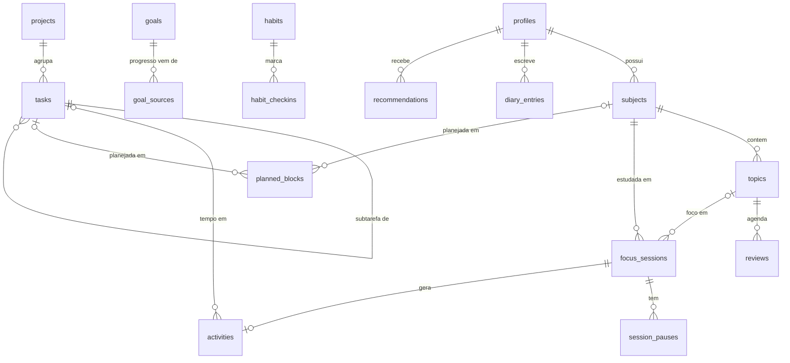

# LifeOS — Modelo de dados (conceitual)

> Proposta para a Fase 2. **Ainda não implementada nem executada contra um banco.** As migrações reais serão criadas em `supabase/migrations/` e verificadas com testes pgTAP antes de serem consideradas concluídas.

## 1. Convenções

- PostgreSQL (Supabase). Tabelas em inglês, `snake_case`, plural.
- Chave primária `id uuid default gen_random_uuid()`.
- Toda tabela de usuário tem `user_id uuid not null default auth.uid() references auth.users on delete cascade`.
- `created_at timestamptz not null default now()`, `updated_at` mantido por trigger.
- Instantes em `timestamptz` (UTC). Durações em **segundos** no banco (precisão), minutos na interface.
- Exclusão: `archived_at` para entidades de organização (matérias, projetos, hábitos, metas); exclusão real para registros a pedido do usuário.
- RLS habilitado em todas as tabelas (ver §4).

## 2. Diagrama



## 3. Entidades

| Tabela            | Campos principais                                                                                                                                                 | Regras                                                                                                                                 |
| ----------------- | ----------------------------------------------------------------------------------------------------------------------------------------------------------------- | -------------------------------------------------------------------------------------------------------------------------------------- |
| `profiles`        | `id` (= `auth.users.id`), `display_name`, `timezone` (IANA), `week_starts_on`, `theme_preference`                                                                 | Criado por trigger no cadastro                                                                                                         |
| `subjects`        | `name`, `color`, `term`, `archived_at`                                                                                                                            | `unique (user_id, lower(name)) where archived_at is null`                                                                              |
| `topics`          | `subject_id`, `name`, `position`                                                                                                                                  | Mesmo `user_id` da matéria (FK composta)                                                                                               |
| `focus_sessions`  | `subject_id?`, `topic_id?`, `task_id?`, `started_at`, `ended_at?`, `status` (`running`/`paused`/`completed`/`discarded`), `planned_seconds?`                      | RN-06: índice único parcial `(user_id) where status in ('running','paused')`                                                           |
| `session_pauses`  | `session_id`, `started_at`, `ended_at?`                                                                                                                           | RN-05: no máximo uma pausa aberta por sessão (índice único parcial); pausa dentro do intervalo da sessão                               |
| `activities`      | `title`, `category`, `started_at`, `ended_at`, `duration_seconds`, `source` (`timer`/`manual`), `session_id?`, `task_id?`, `project_id?`, `subject_id?`, `notes?` | RN-03/04; `ended_at > started_at`; `duration_seconds >= 0`; RN-08 via constraint de exclusão `tstzrange` (ou aviso, decisão na Fase 2) |
| `projects`        | `name`, `description`, `status`, `due_at?`, `archived_at`                                                                                                         | Progresso derivado (RN-09), sem coluna de progresso                                                                                    |
| `tasks`           | `project_id?`, `parent_task_id?`, `title`, `notes`, `status`, `priority`, `due_at?`, `estimate_minutes?`, `completed_at?`                                         | Estimativa é planejamento; `completed_at` coerente com `status` (check)                                                                |
| `planned_blocks`  | `title`, `kind`, `starts_at`, `ends_at`, `task_id?`, `subject_id?`                                                                                                | "Planejado" (RN-02)                                                                                                                    |
| `goals`           | `title`, `unit`, `target_value`, `start_at`, `due_at?`, `mode` (`automatic`/`manual`), `manual_value?`                                                            | RN-10                                                                                                                                  |
| `goal_sources`    | `goal_id`, `source_type`, `source_id`                                                                                                                             | Define de onde vem o progresso automático                                                                                              |
| `habits`          | `name`, `schedule` (jsonb validado), `archived_at`                                                                                                                | —                                                                                                                                      |
| `habit_checkins`  | `habit_id`, `local_date`, `value?`                                                                                                                                | `unique (habit_id, local_date)`; RN-11                                                                                                 |
| `diary_entries`   | `local_date`, `content`, `mood?` (1–5), `energy?` (1–5)                                                                                                           | RN-12: `unique (user_id, local_date)`                                                                                                  |
| `reviews`         | `topic_id`, `due_at`, `completed_at?`, `grade?`, `interval_days`                                                                                                  | Algoritmo decidido na Fase 5                                                                                                           |
| `recommendations` | `rule_id`, `title`, `rationale`, `evidence` (jsonb), `status`, `expires_at`                                                                                       | RN-14                                                                                                                                  |

### Duração líquida de uma sessão (RN-04)

```
duração = (ended_at − started_at) − Σ (pausa.ended_at − pausa.started_at)
```

Calculada no servidor ao encerrar (função `complete_focus_session(session_id)`), que também cria a `activity` correspondente na mesma transação. O cliente nunca envia a duração.

## 4. Segurança (RLS)

Padrão para toda tabela com `user_id`:

```sql
alter table public.<tabela> enable row level security;

create policy "<tabela>: dono lê"     on public.<tabela> for select using (user_id = auth.uid());
create policy "<tabela>: dono cria"   on public.<tabela> for insert with check (user_id = auth.uid());
create policy "<tabela>: dono altera" on public.<tabela> for update using (user_id = auth.uid()) with check (user_id = auth.uid());
create policy "<tabela>: dono exclui" on public.<tabela> for delete using (user_id = auth.uid());
```

Além disso:

- FKs compostas `(id, user_id)` impedem referenciar linhas de outro usuário mesmo com UUID conhecido.
- Trigger impede alterar `user_id` após a criação.
- Funções `security definer` só quando inevitável, com `search_path` fixo e checagem de `auth.uid()`.
- Testes pgTAP: usuário A não lê, altera, exclui nem referencia dados do usuário B.

## 5. Leituras agregadas

O dashboard consumirá uma função `dashboard_summary(p_now timestamptz)` (ou views) que respeita RLS (`security invoker`) e retorna exatamente o contrato `DashboardSummary` de `src/types/domain.ts`.

## 6. Mapeamento interface ↔ banco

| Interface (`types/domain.ts`) | Origem                                         |
| ----------------------------- | ---------------------------------------------- |
| `AgendaItem`                  | `planned_blocks` do dia local                  |
| `TaskSummary`                 | `tasks` não concluídas, por prioridade e prazo |
| `GoalProgress`                | `goals` + agregação de `goal_sources`          |
| `StudySummary.planned*`       | `planned_blocks` (kind = study)                |
| `StudySummary.actual*`        | `activities` ligadas a matérias                |
| `ReviewItem`                  | `reviews` pendentes                            |
| `ActivityEntry`               | `activities` recentes                          |
| `Recommendation`              | `recommendations` ativas                       |
