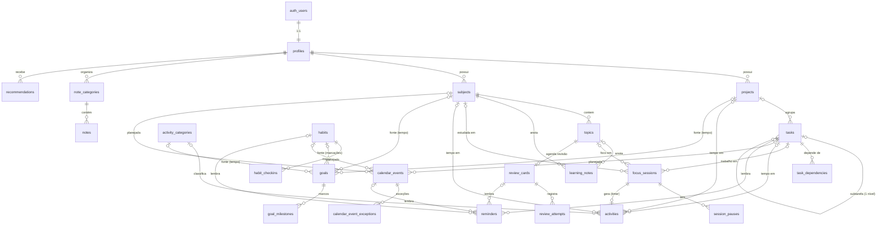

# LifeOS — Modelo de dados (relacional)

> **Estado:** implementado nas migrations de `supabase/migrations/` (Fase 2) e verificado por
> 262 asserções pgTAP em `supabase/tests/database/`, executadas num PostgreSQL limpo. Este
> documento descreve o esquema; a fonte da verdade são as migrations.

## 1. Convenções

| Tema                     | Regra                                                                                                                                                                                                                                              |
| ------------------------ | -------------------------------------------------------------------------------------------------------------------------------------------------------------------------------------------------------------------------------------------------- |
| Nomes                    | Tabelas em inglês, `snake_case`, plural. Restrições nomeadas (`<tabela>_<regra>`), para que erros sejam rastreáveis.                                                                                                                               |
| Chave primária           | `id uuid default gen_random_uuid()`. Exceções: `profiles.id` (= `auth.users.id`) e `task_dependencies` (PK composta).                                                                                                                              |
| Dono                     | `user_id uuid not null default auth.uid() references profiles(id) on delete cascade` em toda tabela de dados pessoais.                                                                                                                             |
| Integridade entre contas | Tabelas-pai têm `unique (id, user_id)`; filhas referenciam `(fk, user_id)`. Uma FK composta torna **impossível** ligar um registro próprio a um registro de outra conta, mesmo conhecendo o UUID (testado em `02_rls_isolation`).                  |
| Auditoria                | `created_at` e `updated_at` (`timestamptz`) em todas as tabelas. O trigger `private.protect_owned_row` impede alterar `user_id`/`created_at` e atualiza `updated_at` a cada `UPDATE`.                                                              |
| Valores enumerados       | `text` + `CHECK` (não `ENUM` do Postgres): adicionar/remover valores é uma migration simples e reversível.                                                                                                                                         |
| Texto livre              | Limites de tamanho em `CHECK` (títulos 200, notas 2–10 mil, diário 100 mil caracteres) e títulos não podem ser só espaços.                                                                                                                         |
| JSON                     | Usado apenas em `recommendations.evidence` (retrato imutável das evidências). Nenhum relacionamento é guardado em JSON.                                                                                                                            |
| Derivados                | Progresso de projeto (RN-09), sequência de hábito (RN-11) e progresso de metas automáticas (RN-10) **não** são colunas: são calculados. A única cópia controlada é `activities` de cronômetro, mantida por triggers a partir da sessão (ver §4.3). |

## 2. Estratégia de datas e fusos (RN-13)

| Tipo de valor                               | Tipo no PostgreSQL              | Exemplos                                                                                    | Regra                                                                                |
| ------------------------------------------- | ------------------------------- | ------------------------------------------------------------------------------------------- | ------------------------------------------------------------------------------------ |
| Instante (aconteceu/acontecerá num momento) | `timestamptz`                   | `started_at`, `ended_at`, `starts_at`, `remind_at`, auditoria                               | Armazenado em UTC. Nunca `timestamp` sem fuso.                                       |
| Data de calendário (não tem hora nem fuso)  | `date`                          | `tasks.due_on`, `habit_checkins.local_date`, `goals.start_on/due_on`, `review_cards.due_on` | É a data **no calendário do usuário**. Não é convertida ao mudar de fuso.            |
| Evento de dia inteiro                       | `date` + `date` (fim exclusivo) | `calendar_events.start_date/end_date`                                                       | Feriado em 02/11 é `[2026-11-02, 2026-11-03)` em qualquer fuso.                      |
| Fuso do usuário                             | `text` (IANA, validado)         | `profiles.timezone = 'America/Sao_Paulo'`                                                   | Define o que é "hoje". Validado contra `pg_timezone_names`.                          |
| Fuso de um evento                           | `text` (IANA)                   | `calendar_events.timezone`                                                                  | Recorrências são expandidas no horário local desse fuso (horário de verão incluído). |
| Duração                                     | `integer` (segundos)            | `activities.duration_seconds`                                                               | Segundos no banco; minutos na interface.                                             |

**Conversões.** O "dia local" é calculado no servidor como
`[ (data::timestamp) at time zone tz , ((data+1)::timestamp) at time zone tz )` — por isso um dia
pode ter 23 ou 25 horas (testado com 01/11/2026 em `America/New_York`). A interface formata
instantes com `Intl.DateTimeFormat({ timeZone: perfil.timezone })` e nunca usa o fuso implícito
do navegador (`src/lib/date.ts`).

**Sessões que atravessam a meia-noite.** São guardadas como um único intervalo. Ao atribuir tempo
a um dia, `private.activity_seconds_in_range` recorta o intervalo nos limites do dia local e
desconta **somente as pausas que caem naquele dia**: uma sessão 23:30–00:30 com pausa 00:10–00:20
conta 30 min ontem e 20 min hoje (exato, não proporcional).

**Recorrência.** `calendar_events.recurrence_rule` guarda uma RRULE (RFC 5545) e
`calendar_event_exceptions` guarda ocorrências canceladas/alteradas, identificadas pelo início
**original**. A expansão das ocorrências é da Fase 5 (calendário); até lá, o resumo do dashboard
considera apenas eventos não recorrentes.

## 3. Diagrama

## 4. Entidades

Política de acesso **padrão** (todas as tabelas com `user_id`): RLS habilitado; para o papel
`authenticated`, quatro políticas — o dono lê, cria, altera e exclui (`user_id = auth.uid()`, com
`WITH CHECK` em INSERT/UPDATE). `anon` não tem nenhum privilégio. `service_role` (só no servidor)
tem acesso total. Exceções estão indicadas.

### 4.1 Conta

| Tabela     | Propósito                               | Campos principais                                                                                                  | Relações / regras                                                                                                                            | Acesso                                                                                                           |
| ---------- | --------------------------------------- | ------------------------------------------------------------------------------------------------------------------ | -------------------------------------------------------------------------------------------------------------------------------------------- | ---------------------------------------------------------------------------------------------------------------- |
| `profiles` | Perfil e preferências (1:1 com a conta) | `display_name` (≤ 80), `timezone` (IANA válido), `week_starts_on` (0–6), `theme_preference`, `email_notifications` | `id → auth.users ON DELETE CASCADE`. Criado pelo trigger `on_auth_user_created` com metadados do cadastro validados (fuso inválido → `UTC`). | Dono lê e altera **só as colunas de preferência** (GRANT por coluna). Não cria nem exclui (vem/vai com a conta). |

### 4.2 Planejamento

| Tabela              | Propósito                        | Campos principais                                                                                                                                       | Relações / regras                                                                                                                                                                                                               |
| ------------------- | -------------------------------- | ------------------------------------------------------------------------------------------------------------------------------------------------------- | ------------------------------------------------------------------------------------------------------------------------------------------------------------------------------------------------------------------------------- |
| `projects`          | Agrupar tarefas por resultado    | `name`, `description`, `status` (planned/active/on_hold/completed/cancelled), `start_on`, `due_on`, `completed_at`, `archived_at`                       | `completed_at` mantido pelo servidor a partir do `status`. Progresso **derivado** (RN-09).                                                                                                                                      |
| `tasks`             | Itens acionáveis                 | `title`, `notes`, `status` (todo/in_progress/done/cancelled), `priority`, `due_on` (date), `estimate_minutes` (planejado), `sort_order`, `completed_at` | `project_id → projects ON DELETE SET NULL (project_id)`; `parent_task_id → tasks ON DELETE CASCADE`. Subtarefas: **um nível**, herdam o projeto da mãe (trigger); mover a mãe move as filhas. `completed_at` ⇔ `status = done`. |
| `task_dependencies` | "A só pode ser concluída após B" | PK (`task_id`, `depends_on_task_id`)                                                                                                                    | Ambas as FKs compostas `ON DELETE CASCADE`. Sem autodependência; **sem ciclos** (trigger com busca recursiva).                                                                                                                  |

### 4.3 Estudos e tempo

| Tabela                | Propósito                                       | Campos principais                                                                                                                                                                     | Relações / regras                                                                                                                                                                                                                                                                                    |
| --------------------- | ----------------------------------------------- | ------------------------------------------------------------------------------------------------------------------------------------------------------------------------------------- | ---------------------------------------------------------------------------------------------------------------------------------------------------------------------------------------------------------------------------------------------------------------------------------------------------- |
| `subjects`            | Matérias                                        | `name`, `color` (#RRGGBB), `term`, `archived_at`                                                                                                                                      | Nome único por usuário entre as ativas (sem diferenciar maiúsculas).                                                                                                                                                                                                                                 |
| `topics`              | Tópicos de uma matéria                          | `subject_id`, `name`, `sort_order`, `archived_at`                                                                                                                                     | `→ subjects ON DELETE CASCADE`. Nome único por matéria entre os ativos.                                                                                                                                                                                                                              |
| `learning_notes`      | Anotações de aprendizado (Markdown)             | `subject_id`, `topic_id?`, `title`, `content`                                                                                                                                         | Com tópico, a matéria é **derivada do tópico** (trigger) — combinação incoerente é impossível.                                                                                                                                                                                                       |
| `focus_sessions`      | Cronômetro (RN-04/05/06/07)                     | `subject_id?`, `topic_id?`, `task_id?`, `status` (active/completed/discarded), `started_at`, `ended_at`, `planned_seconds`, `note`                                                    | **Uma ativa por usuário** (índice único parcial). `ended_at` ⇔ status ≠ active. Estados só avançam (active → completed/discarded). "Pausada" não é status: é ter uma pausa aberta (fonte única).                                                                                                     |
| `session_pauses`      | Pausas de uma sessão                            | `session_id`, `started_at`, `ended_at?`                                                                                                                                               | **Uma aberta por sessão** (índice único parcial); pausas não se sobrepõem (`EXCLUDE USING gist`); ficam dentro do intervalo da sessão (triggers nos dois lados).                                                                                                                                     |
| `activity_categories` | Categorias definidas pelo usuário               | `name`, `color`, `archived_at`                                                                                                                                                        | Nome único entre as ativas.                                                                                                                                                                                                                                                                          |
| `activities`          | **Fonte única do tempo realizado** (RN-03)      | `title`, `category_id?`, `source` (timer/manual), `session_id?` (único), `started_at`, `ended_at`, `duration_seconds`, `subject_id?`, `topic_id?`, `task_id?`, `project_id?`, `notes` | `duration_seconds` é **sempre calculada pelo servidor**: manual = fim − início; cronômetro = líquido da sessão (RN-04). Encerrar uma sessão cria a atividade na mesma transação; corrigir a sessão/pausas a recalcula. Com tarefa, o projeto vem da tarefa (`task_id` e `project_id` não coexistem). |
| `review_cards`        | Estado de revisão espaçada de um tópico (plano) | `topic_id` (único), `status`, `due_on`, `interval_days`, `repetitions`, `last_reviewed_at`                                                                                            | Algoritmo (SM-2/FSRS) decidido na Fase 6; colunas específicas entram por migration nova.                                                                                                                                                                                                             |
| `review_attempts`     | Tentativas de revisão (fatos)                   | `review_card_id`, `reviewed_at`, `grade` (1–4), `duration_seconds?`, `notes`                                                                                                          | `→ review_cards ON DELETE CASCADE`.                                                                                                                                                                                                                                                                  |

### 4.4 Acompanhamento

| Tabela            | Propósito               | Campos principais                                                                                                                                                                                                     | Relações / regras                                                                                                                                                                                                                                  |
| ----------------- | ----------------------- | --------------------------------------------------------------------------------------------------------------------------------------------------------------------------------------------------------------------- | -------------------------------------------------------------------------------------------------------------------------------------------------------------------------------------------------------------------------------------------------- |
| `habits`          | Definição de hábito     | `name`, `schedule_kind` (daily/weekdays/times_per_week), `weekdays smallint[]` (0–6), `times_per_week`, `target_value`+`unit`, `start_on`, `archived_at`                                                              | Recorrência **relacional** (colunas validadas), não JSON genérico.                                                                                                                                                                                 |
| `habit_checkins`  | Marcação de cumprimento | `habit_id`, `local_date`, `value?`, `note`                                                                                                                                                                            | Uma por hábito por dia (`unique`). Sequência é calculada (RN-11).                                                                                                                                                                                  |
| `goals`           | Metas                   | `title`, `status`, `progress_mode` (manual/activity_time/habit_checkins), `target_value`, `unit`, `manual_current_value?`, fontes (`subject_id`/`project_id`/`activity_category_id`/`habit_id`), `start_on`, `due_on` | Coerência modo × fonte em `CHECK`. Metas por tempo medem horas (`unit = 'h'`) e têm no máximo uma fonte; por hábito exigem o hábito. Fontes usam `NO ACTION`: não se exclui a fonte de uma meta (arquiva-se), mas a exclusão da conta remove tudo. |
| `goal_milestones` | Marcos de uma meta      | `goal_id`, `title`, `target_value?`, `due_on?`, `achieved_at?`, `sort_order`                                                                                                                                          | `→ goals ON DELETE CASCADE`.                                                                                                                                                                                                                       |
| `note_categories` | Notas                   | `name`, `color` (#rrggbb), `parent_id` (subcategoria; 2 níveis), `position`                                                                                                                                           |
| `notes`           | Notas                   | `category_id`, `title`, `content` (documento do editor, JSON), `content_text` (texto para busca), `pinned`                                                                                                            |

> **Livros e leitura.** Não há tabela própria: nenhum caso de uso atual exige catálogo de livros.
> Leitura é registrada como atividade (categoria "Leitura"), hábito ("20 páginas") ou meta manual
> ("6 livros no ano"). Ver ADR-017.

### 4.5 Calendário (tudo é **planejado** — RN-02)

| Tabela                      | Propósito                        | Campos principais                                                                                                                                                             | Regras                                                                                                                                         |
| --------------------------- | -------------------------------- | ----------------------------------------------------------------------------------------------------------------------------------------------------------------------------- | ---------------------------------------------------------------------------------------------------------------------------------------------- |
| `calendar_events`           | Blocos de tempo e compromissos   | `title`, `kind` (event/study/task/habit), `all_day`, `starts_at/ends_at` **ou** `start_date/end_date`, `timezone`, `recurrence_rule?`, `task_id?`, `subject_id?`, `habit_id?` | `CHECK` garante uma única forma (com horário XOR dia inteiro) e fim > início. RRULE com formato validado. Substitui o antigo `planned_blocks`. |
| `calendar_event_exceptions` | Ocorrência cancelada ou alterada | `event_id`, `original_starts_at` **ou** `original_date`, `kind` (cancelled/modified), `new_title?`, `new_starts_at?`, `new_ends_at?`                                          | Uma exceção por ocorrência original.                                                                                                           |

### 4.6 Engajamento

| Tabela            | Propósito                                  | Campos principais                                                                                                                                                             | Regras e acesso                                                                                                                                                                                                          |
| ----------------- | ------------------------------------------ | ----------------------------------------------------------------------------------------------------------------------------------------------------------------------------- | ------------------------------------------------------------------------------------------------------------------------------------------------------------------------------------------------------------------------ |
| `recommendations` | Sugestões explicáveis + decisão do usuário | `rule_id`, `title`, `rationale` (obrigatória), `evidence` (jsonb), `status` (pending/accepted/dismissed/expired), `generated_at`, `expires_at`, `decided_at`, `decision_note` | **Exceção de acesso:** o navegador não cria nem reescreve recomendações; só pode alterar `status` e `decision_note` (GRANT por coluna) e excluir. `decided_at` é registrado pelo servidor; decisão não volta a pendente. |
| `reminders`       | Lembretes                                  | `title`, `remind_at`, `channel` (in_app/email), no máximo um alvo (`task_id`/`calendar_event_id`/`habit_id`/`review_card_id`), `sent_at`, `dismissed_at`                      | Entrega depende de agendador (fase futura). Índice da fila: pendentes por `remind_at`.                                                                                                                                   |

## 5. Regras de exclusão e de atualização

| Situação                      | Comportamento                                                                                                                                                                              |
| ----------------------------- | ------------------------------------------------------------------------------------------------------------------------------------------------------------------------------------------ |
| Conta excluída (`auth.users`) | `profiles` e **todas** as tabelas caem em cascata (testado: nenhuma linha órfã em nenhuma tabela).                                                                                         |
| Matéria excluída              | Tópicos, anotações e cartões de revisão: cascata. Sessões, atividades, eventos: a referência vira `NULL` (o tempo registrado continua). Se for fonte de uma meta: **bloqueado** (arquive). |
| Projeto excluído              | Tarefas permanecem sem projeto (`SET NULL` só da coluna `project_id`).                                                                                                                     |
| Tarefa excluída               | Subtarefas, dependências e lembretes: cascata. Sessões, atividades, eventos: referência `NULL`.                                                                                            |
| Sessão excluída               | Pausas e a atividade gerada: cascata.                                                                                                                                                      |
| Atualização de chaves         | IDs não mudam (`ON UPDATE NO ACTION`); `user_id` e `created_at` são imutáveis (trigger).                                                                                                   |

`SET NULL (coluna)` (PostgreSQL 15+) anula **só** a coluna da FK, preservando o `user_id` da FK composta.

## 6. Índices

- Toda FK tem índice cuja primeira coluna é a da FK (índices parciais `WHERE col IS NOT NULL` contam,
  pois atendem à busca `col = $1`) — verificado por teste de catálogo.
- `user_id` indexado em todas as tabelas (exclusão em cascata e filtros do RLS).
- Consultas por período usam GiST em `(user_id, tstzrange(início, fim))` (`activities`, eventos com horário).
- Índices parciais para os casos frequentes: tarefas abertas, metas ativas, cartões ativos por data,
  recomendações pendentes, fila de lembretes.

## 7. Funções (RPC) e segurança das funções

| Função                                              | Segurança     | Propósito                                                                                                                                      |
| --------------------------------------------------- | ------------- | ---------------------------------------------------------------------------------------------------------------------------------------------- |
| `start/pause/resume/complete/discard_focus_session` | INVOKER (RLS) | Ciclo de vida do cronômetro com o relógio do servidor; mensagens claras para RN-05/06.                                                         |
| `dashboard_summary(p_now)`                          | INVOKER (RLS) | Resumo do dia no fuso do perfil; retorna exatamente o contrato `DashboardSummary` (validado com Zod na interface).                             |
| `export_my_data()`                                  | INVOKER (RLS) | Todos os dados do usuário em JSON (portabilidade).                                                                                             |
| `delete_my_account()`                               | **DEFINER**   | Única forma de remover a linha em `auth.users`. Age apenas sobre `auth.uid()` (sem parâmetro), `search_path` vazio, não executável por `anon`. |
| `private.handle_new_user()` (trigger)               | **DEFINER**   | Cria o perfil no cadastro (roda no contexto do serviço de Auth).                                                                               |

Garantias testadas em `01_security_catalog`: só essas duas funções são `SECURITY DEFINER`; toda função
fixa `search_path = ''`; `anon` não executa nenhuma função; utilitários de migration não são executáveis
pela API; não existem views (que poderiam contornar o RLS).

## 8. Mapeamento interface ↔ banco

| Interface (`src/types/domain.ts`) | Origem                                                                        |
| --------------------------------- | ----------------------------------------------------------------------------- |
| `AgendaItem`                      | `calendar_events` não recorrentes que tocam o dia local                       |
| `TaskSummary`                     | `tasks` abertas, por prioridade e `due_on`                                    |
| `GoalProgress`                    | `goals` ativas; `current` calculado conforme `progress_mode`                  |
| `StudySummary.planned*`           | `calendar_events` com `kind = 'study'` (recortados ao dia)                    |
| `StudySummary.actual*`            | `activities` com matéria (líquido, recortado ao dia/7 dias)                   |
| `ReviewItem`                      | `review_cards` ativos com `due_on` até hoje + 7                               |
| `ActivityEntry`                   | `activities` mais recentes                                                    |
| `Recommendation`                  | `recommendations` pendentes e não expiradas                                   |
| `Profile`                         | `profiles` (colunas em camelCase em `services/profile/profile-repository.ts`) |

Tipos das tabelas: `src/services/supabase/database.types.ts`, no formato do `supabase gen types`.

## 9. Fase 3 — módulos centrais: mudanças e regras de negócio

Migrations novas (as da Fase 2 não foram reescritas): `20261021120000_tasks_projects`,
`…120100_studies_activities`, `…120200_reviews_reflections`, `…120300_goals_habits_diary` e
`…120400_api_v2`. Testes: `supabase/tests/database/05_phase3_rules.test.sql` (86 asserções) além da
atualização de 01–04 (catálogo de segurança e isolamento cobrem automaticamente as tabelas novas).

### 9.1 Tabelas e colunas novas

| Tabela                                                                                | Para quê                                 | Observações                                                                                      |
| ------------------------------------------------------------------------------------- | ---------------------------------------- | ------------------------------------------------------------------------------------------------ |
| `tasks` (+ `description`, `start_on`, `category_id`, `started_at`, `cancelled_at`)    | Execução e pontualidade                  | `started_at` = 1ª vez em andamento; `cancelled_at` ≠ `completed_at`; prazo ≥ início              |
| `projects` (+ `priority`, `notes`)                                                    |                                          |                                                                                                  |
| `project_milestones`                                                                  | Marcos do projeto                        | Cascata com o projeto                                                                            |
| `project_status_history`                                                              | Histórico de status (gatilho)            | Somente inclusão (UPDATE revogado)                                                               |
| `subjects` (+ `description`, `objective`, `target_minutes_per_week`, `status`)        | Carga pretendida = planejamento          | Comparada ao tempo real (sessões/atividades)                                                     |
| `topics` (+ `parent_topic_id`, `description`, `priority`, `difficulty`, `notes`)      | Subtópicos (um nível)                    | Subtópico herda a matéria; mover o pai leva os filhos                                            |
| `topic_mastery_events`                                                                | Domínio como **histórico**               | Origem `manual`, `session` ou `review`; o atual é o mais recente                                 |
| `focus_sessions` (+ `technique`)                                                      | Técnica de estudo                        | ≤ 24 h; nada no futuro (tolerância 5 min); inserir já encerrada = registro manual                |
| `session_reflections`                                                                 | Reflexão pós-sessão                      | 1 por sessão; acertos ≤ questões                                                                 |
| `review_cards` (+ `priority`), `review_schedule_log`                                  | Fila e histórico de datas                | Log somente inclusão, com motivo (`created`, `completed`, `postponed`, `rescheduled`, `session`) |
| `activities` (+ `kind`, `pages`, `reading_title`, `distance_km`, `intensity`)         | Atividade por tipo                       | Métricas só no tipo certo; matéria/tópico só em `study`; cronômetro = sempre `study`             |
| `goals` (+ `period`, `activity_kind`, `archived_at`; `manual_current_value` removido) | Metas por ciclo                          | Unidade canônica nos tipos derivados                                                             |
| `goal_progress_entries`                                                               | Lançamentos datados das metas manuais    | Valor manual antigo migrado para um lançamento                                                   |
| `goal_changes`                                                                        | Alterações de alvo, ciclo, tipo e status | Somente inclusão                                                                                 |
| `habits` (+ `status`), `diary_entries` (+ `title`)                                    |                                          |                                                                                                  |

### 9.2 Tarefas

- **Atrasada** = aberta (`todo`/`in_progress`) com prazo antes de hoje (fuso do perfil). É só um
  destaque: o status nunca muda sozinho.
- **Dependências bloqueiam a conclusão** (gatilho `tasks_enforce_completion_rules`): só conclui com
  todos os pré-requisitos concluídos ou cancelados. Iniciar é permitido (a interface alerta). Ciclos
  são recusados no banco e nem oferecidos na interface.
- **Subtarefas** (um nível): a mãe só é concluída sem subtarefas abertas. `complete_task(id, true)`
  conclui as abertas na mesma transação, sempre por escolha explícita do usuário — o sistema **nunca**
  conclui a mãe sozinho, nem quando a última subtarefa é concluída.
- **Cancelar** a mãe cancela as subtarefas abertas (as concluídas ficam). Reabrir limpa
  `completed_at`/`cancelled_at` e preserva `started_at`.
- **Pontualidade** (análise futura): data local da conclusão × prazo → no prazo / depois / sem prazo.

### 9.3 Projetos

- **Progresso** = concluídas ÷ (tarefas do projeto − canceladas), subtarefas incluídas. Sem tarefas
  válidas = desconhecido (—), não 0 %. Nunca é um percentual digitado. Marcos têm contagem própria.
- **Arquivar** tira de vista sem perder nada. **Excluir** remove marcos e histórico; as tarefas
  continuam, sem projeto (FK `SET NULL`); metas ligadas impedem a exclusão (mensagem explicativa).

### 9.4 Estudos, cronômetro e revisões

- **Tempo** sempre derivado de instantes do servidor (início, pausas, fim). Recarregar a página não
  altera nada; só existe uma sessão ativa por usuário (índice único).
- **Sessão interrompida**: `complete_focus_session_at(id, fim)` encerra num instante escolhido entre o
  início e agora; pausas posteriores são descartadas.
- **Correção**: `correct_focus_session(id, início, fim)` ajusta as pausas à nova janela (remove as que
  ficam de fora), então o tempo líquido nunca fica negativo; a atividade é recalculada pelo gatilho.
- **Meia-noite**: a sessão é um intervalo de instantes; estatísticas por dia usam a interseção com o
  dia local (`activity_seconds_in_range`).
- **Reflexão**: questões/acertos geram um registro de domínio de origem `session`
  (< 50 % → 1, < 70 % → 2, < 90 % → 3, ≥ 90 % → 4); corrigir a reflexão substitui esse registro. A data
  sugerida agenda a revisão do tópico.
- **Domínio** nunca é um campo editável: ajustes manuais viram registros `manual` com motivo.
- **Revisão (ADR-025)**: escada 1 · 3 · 7 · 14 · 30 · 60 · 120 · 240 dias. Nota 1 → volta para amanhã
  (repetições = 0); 2 → mantém o degrau; 3 → sobe um; 4 → sobe dois. `complete_review` registra a
  tentativa e o domínio (origem `review`) e é idempotente por 60 s (clique duplo/rede). Adiar
  (1–60 dias) e reagendar (hoje ou futuro) ficam no log com motivo; o histórico nunca é apagado.

### 9.5 Metas

| Tipo (`progress_mode`) | Valor no ciclo                                 | Unidade    | Filtro opcional                          |
| ---------------------- | ---------------------------------------------- | ---------- | ---------------------------------------- |
| `activity_time`        | Horas das atividades (interseção, pausas fora) | h          | uma: matéria, categoria, tipo ou projeto |
| `study_sessions`       | Sessões concluídas com tempo > 0               | sessões    | matéria                                  |
| `questions`            | Questões das reflexões                         | questões   | matéria                                  |
| `pages`                | Páginas das atividades de leitura              | páginas    | —                                        |
| `tasks_completed`      | Tarefas concluídas no ciclo                    | tarefas    | projeto                                  |
| `habit_checkins`       | Dias em que o hábito foi **cumprido**          | vezes      | hábito (obrigatório)                     |
| `manual`               | Soma dos lançamentos (negativos corrigem)      | do usuário | — (sempre sinalizada como manual)        |

- **Ciclos** (`private.goal_cycle`): diário, semanal (início da semana do perfil), mensal ou `once`
  (do início até o prazo). O primeiro ciclo não começa antes do início da meta; o ciclo atual é
  contado até hoje, no fuso do perfil.
- `goal_progress(now)` devolve o ciclo atual de cada meta ativa e não arquivada;
  `goal_history(id, n)` devolve os últimos n ciclos (metas `once`: semanas). Como tudo é calculado dos
  registros, **editar a meta não reescreve o passado**; editar/excluir um registro atualiza o valor.

### 9.6 Hábitos

- **Dia elegível**: dia em que o hábito é esperado (todo dia ou dias da semana escolhidos, a partir do
  início). "N vezes por semana" é avaliado por **semana** (início do perfil).
- **Cumprido**: existe marcação e, se há meta por marcação, o valor a atinge. Abaixo da meta fica
  registrado ("parcial"), mas não conta.
- **Sequência**: períodos elegíveis consecutivos cumpridos; dias não elegíveis são ignorados. O período
  atual não quebra a sequência enquanto não termina. **Consistência**: cumpridos ÷ elegíveis (30 e
  90 dias), mostrada junto com a sequência. Regras em `modules/habits/logic/habits.ts` (testadas).
- Uma marcação por hábito e dia (restrição única): marcar de novo corrige o valor; desfazer exclui.

### 9.7 Atividades, notas e calendário

- Atividade do cronômetro: horários vêm da sessão; excluir a atividade exclui a sessão de origem.
- Notas (substituem o Diário, removido em `20261104120000_notes`): categorias e subcategorias do próprio usuário (nomes únicos entre irmãos), excluir categoria com notas é recusado (`ON DELETE RESTRICT`, a interface move as notas antes); imagens no bucket privado `note-images` (pasta `<user_id>/`); vídeos só como link.
- Calendário: recorrência guardada como **regra** (subconjunto da RFC 5545) e expandida na interface só
  na janela visível, no fuso do evento (ADR-026). Arrastar uma ocorrência de série cria uma exceção
  (`modified`) só para ela; "remover esta ocorrência" cria uma exceção `cancelled`. Prazos de tarefas,
  revisões e tempo realizado aparecem no calendário mas **não são eventos** (somente leitura). Um bloco
  ligado a uma tarefa nunca a conclui. Não há notificações.

### 9.8 Dashboard (`dashboard_summary` v2)

Contrato: `priorityTasks` (atrasadas primeiro, depois prioridade e prazo; até 6), `goals` (ciclo
atual, até 4), `studies` (realizado hoje e em 7 dias, por matéria — só atividades `study`), `reviews`,
`reviewCounts`, `recentActivities` (com `kind`), `activeProjects` (com contagem de tarefas),
`recommendations` e `setup` (contagens para adaptar a tela). A **agenda** e os **minutos planejados**
saíram do servidor: a interface monta a agenda do dia com a mesma expansão de recorrências do
calendário, e os hábitos de hoje com as mesmas regras de elegibilidade.

### 9.9 Exclusões (resumo)

| Excluir… | Sai junto (cascata)                                  | Fica, sem o vínculo (SET NULL)            | Impede        |
| -------- | ---------------------------------------------------- | ----------------------------------------- | ------------- |
| Tarefa   | subtarefas, dependências                             | sessões, atividades, blocos do calendário | —             |
| Projeto  | marcos, histórico de status                          | tarefas, atividades                       | metas ligadas |
| Matéria  | tópicos, domínio, revisões                           | sessões, atividades, blocos               | metas ligadas |
| Tópico   | subtópicos, domínio, revisão                         | sessões, atividades                       | —             |
| Sessão   | atividade gerada, pausas, reflexão, domínio derivado | —                                         | —             |
| Hábito   | marcações                                            | blocos do calendário                      | metas ligadas |
| Meta     | lançamentos, marcos, alterações                      | — (registros de origem não são afetados)  | —             |
| Revisão  | tentativas, log de datas                             | domínio já registrado                     | —             |

## 10. Fase 4 — integração, estatísticas, recomendações e planejamento

Duas migrations novas (as anteriores não foram alteradas):

- `20261022120000_integration_recommendations.sql`
- `20261022120100_analytics.sql`

### 10.1 Colunas e tabelas novas

| Objeto                        | Mudança                                                                                                                                                                                                                       |
| ----------------------------- | ----------------------------------------------------------------------------------------------------------------------------------------------------------------------------------------------------------------------------- |
| `tasks.goal_id`               | Tarefa ↔ meta. FK composta `(goal_id, user_id)` → `goals`, `ON DELETE SET NULL (goal_id)`                                                                                                                                     |
| `goals.linked_tasks_only`     | Só para metas `tasks_completed`: conta apenas tarefas com `goal_id` = meta (check 23514 nos outros modos)                                                                                                                     |
| `calendar_events.category_id` | Categoria (cor e filtro) → `activity_categories`, `SET NULL`                                                                                                                                                                  |
| `recommendations`             | + `dedup_key`, `priority` (1–3), `action` (jsonb), `snoozed_until`, `closed_at`, `close_reason`, `last_seen_at`; estados `pending/accepted/snoozed/dismissed/resolved/expired`; índice único parcial de uma aberta por escopo |
| `availability_windows`        | Janelas por dia da semana (`weekday` 0–6, `start_time` < `end_time`, sem sobreposição no mesmo dia — exclusão GiST)                                                                                                           |
| `planning_preferences`        | 1 linha por usuário (PK `user_id`): descanso, bloco mínimo/máximo, período preferido, limite diário                                                                                                                           |
| `weekly_reviews`              | Anotações por semana (`unique (user_id, week_start)`)                                                                                                                                                                         |
| `weekly_review_priorities`    | Prioridades ordenadas (`position` 0–20), opcionalmente ligadas a uma tarefa (`SET NULL`); cascata com a revisão                                                                                                               |

Todas as tabelas novas usam `private.secure_owned_table` (RLS com as quatro políticas de dono) e
FKs compostas com `user_id` — referenciar registro de outro usuário falha (23503), testado em
`02_rls_isolation.test.sql`.

### 10.2 Recomendações

- `private.recommendations_guard` (BEFORE INSERT/UPDATE): inserção só pela sincronização (GUC
  `lifeos.recommendation_sync`, definido dentro da função — a API não consegue defini-lo);
  conteúdo (título, motivo, evidências, ação, prioridade) só muda pela sincronização; estados
  encerrados são imutáveis; transições do usuário validadas; adiamento > agora e ≤ 30 dias;
  `decided_at`, `closed_at` e `close_reason` preenchidos pelo banco.
- `public.sync_recommendations(p_candidates jsonb, p_rules text[])` — SECURITY INVOKER (RLS
  vale), ≤ 200 candidatas; reabre adiamentos vencidos, atualiza a aberta do mesmo escopo, respeita
  o período de espera após rejeição/resolução, cria as novas, encerra (`condition_cleared`) as
  abertas das regras avaliadas que não vieram, expira as vencidas e não cria candidatas já
  vencidas. Devolve contadores. Detalhes: `docs/recommendations.md`.
- Privilégios de coluna: o papel `authenticated` só pode `INSERT`/`UPDATE` nas colunas
  necessárias; `user_id` vem do padrão `auth.uid()`.

### 10.3 Funções de estatística (todas SECURITY INVOKER, `search_path = ''`)

| Função                                | Devolve                                                                                                                |
| ------------------------------------- | ---------------------------------------------------------------------------------------------------------------------- |
| `stats_study(p_from, p_to)`           | série diária, por matéria/tópico, totais (cronômetro × manual), sessões (líquido/bruto), questões, revisões            |
| `stats_tasks(p_from, p_to)`           | criadas/concluídas/canceladas, prazos do período, situação atual, série diária, estimado × realizado, projetos, marcos |
| `stats_activities(p_from, p_to)`      | série diária, por tipo/categoria, leitura (páginas, títulos) e exercício (distância)                                   |
| `stats_goals(p_from, p_to)`           | ciclos de cada meta no período com valor e alvo em vigor (`private.goal_target_at`)                                    |
| `task_time_totals(p_task_ids uuid[])` | tempo realizado por tarefa                                                                                             |
| `export_my_data()` v3                 | + disponibilidade, preferências, revisões semanais e prioridades                                                       |

Auxiliares: `private.require_stats_range` (1–731 dias, 22023), `private.local_day_start`,
`private.goal_target_at`; `private.goal_value` passou a respeitar `linked_tasks_only`. Índices por
instante para as agregações (`tasks(user_id, completed_at | created_at | due_on)`,
`review_attempts(user_id, reviewed_at)`, `review_schedule_log(user_id, changed_at)`).
Definições matemáticas: `docs/metrics.md`.

### 10.4 Testes

`06_phase4_rules.test.sql` (62 asserções): sessões com pausa e cruzando a meia-noite, lançamento
manual, sessão iniciada antes do período, correção retroativa e exclusões refletidas, tarefas no
prazo/atrasadas/canceladas, estimado × realizado, metas com alvo alterado e “só vinculadas”, ciclo
de vida e deduplicação de recomendações, disponibilidade sem sobreposição, preferências, uma
revisão por semana, limites de período e cobertura da exportação. Total: **486 asserções**.

## 11. Fase 5 — auditoria final

### 11.1 Migration `20261023120000_phase5_integrity.sql`

Só substitui uma função (nenhuma tabela, coluna ou política mudou):

- **`private.focus_sessions_sync_activity()`** — o trigger que mantém a atividade gerada por uma
  sessão encerrada em sincronia com ela. **Bug corrigido:** excluir uma matéria cujas sessões
  apontavam para um tópico dela falhava com `409` (`activities_topic_fk`). Na mesma exclusão o
  PostgreSQL apaga os tópicos (cascata) e anula `focus_sessions.subject_id` (`SET NULL`); o trigger,
  disparado por essa anulação, copiava para a atividade o `topic_id` do tópico que acabara de ser
  apagado, e a FK recusava a exclusão inteira. Agora o trigger só copia referências que ainda
  existem — o mesmo resultado que o `SET NULL` produziria logo depois.

### 11.2 Escritas idempotentes (sem tabela nova)

Os formulários de criação geram o `id` (UUID v4) no navegador **uma vez** e o reenviam em cada
tentativa (`src/lib/query/draft-id.ts`). Se a resposta da primeira tentativa se perdeu depois de o
servidor gravar, a segunda esbarra na chave primária (`23505`); `insertOnce`
(`src/services/supabase/result.ts`) então lê a linha com **esse** id e a devolve, sem duplicar. O RLS
continua valendo: um id de outra conta nunca é lido. Aplicado a tarefas, projetos, matérias,
tópicos, metas, hábitos, atividades, eventos e sessões manuais. A marcação de hábito usa a chave
natural `(hábito, dia)`: se ela já existe, a marcação deu certo.

### 11.3 Testes

`07_phase5_integrity.test.sql` (38 asserções) monta um grafo completo — matéria com tópicos,
sessões, revisões e anotações; projeto com tarefas, subtarefas, dependências e marcos; metas,
hábitos, eventos e atividades ligados — e exclui cada tipo de registro, conferindo o que permanece
(com a referência anulada) e o que cai em cascata, sem nenhuma linha órfã. Total do pgTAP:
**524 asserções** em 7 arquivos. A varredura de isolamento pela API real (todas as tabelas, duas
contas) está em `src/tests/integration/isolation-sweep.integration.test.ts`.
